# Documentación Técnica - Servicios de Infraestructura para Bavaria

**Proyecto:** Infraestructura de TI - Bavaria (contexto académico)  
**Servidor:** Ubuntu Server 24.04 LTS  
**Entorno:** Máquina virtual  
**Dirección IP utilizada en el laboratorio:** `192.168.18.87`  
**Red local de pruebas:** `192.168.18.0/24`

---

## 1. Contexto de la implementación

En este proyecto académico se configuraron servicios básicos de infraestructura sobre Ubuntu Server 24.04 LTS, tomando a Bavaria como contexto organizacional. Las actividades documentadas comprenden la sincronización horaria mediante Chrony, la administración de impresión con CUPS y la generación de documentos mediante la impresora virtual CUPS-PDF.

La implementación se realizó en un entorno de laboratorio. Por tanto, la dirección IP, la subred, los nombres de host y las configuraciones mostradas corresponden a las pruebas realizadas y no describen la infraestructura productiva de Bavaria.

## 2. Servicio NTP mediante Chrony

**Objetivo:** mantener sincronizado el reloj del servidor y permitir que los equipos autorizados de la red de laboratorio consulten la hora mediante el protocolo NTP.

### 2.1. Instalación de Chrony

Se instaló el servicio Chrony mediante el administrador de paquetes de Ubuntu:

```bash
sudo apt install chrony -y
```

Durante la instalación, el sistema incorporó el paquete `chrony` y sus dependencias. También se observa que se retiró `systemd-timesyncd`, ya que Chrony pasa a encargarse de la función de sincronización horaria del sistema.

**Evidencia 001. Instalación de Chrony**

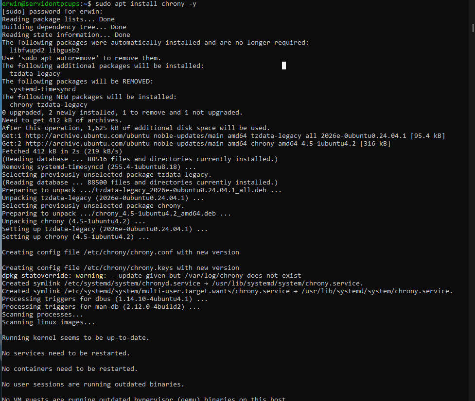

### 2.2. Verificación del servicio y del estado de sincronización

Después de la instalación se consultó el estado del servicio:

```bash
systemctl status chrony
```

La salida mostró `chrony.service` en estado `active (running)` y habilitado para iniciar con el sistema. Posteriormente, se ejecutaron los comandos:

```bash
chronyc tracking
chronyc sources -v
```

`chronyc tracking` presenta información sobre la referencia de tiempo, el estrato, el desfase del reloj y el intervalo de actualización. Por su parte, `chronyc sources -v` permite consultar las fuentes NTP conocidas por Chrony y observar cuál se encuentra seleccionada como referencia.

En la evidencia se observa una fuente marcada como seleccionada (`^*`) y otras fuentes disponibles. Esto indica que Chrony está recibiendo referencias de tiempo y cuenta con una fuente seleccionada para sincronizar el reloj.

**Evidencia 002. Verificación del servicio y de la sincronización con Chrony**

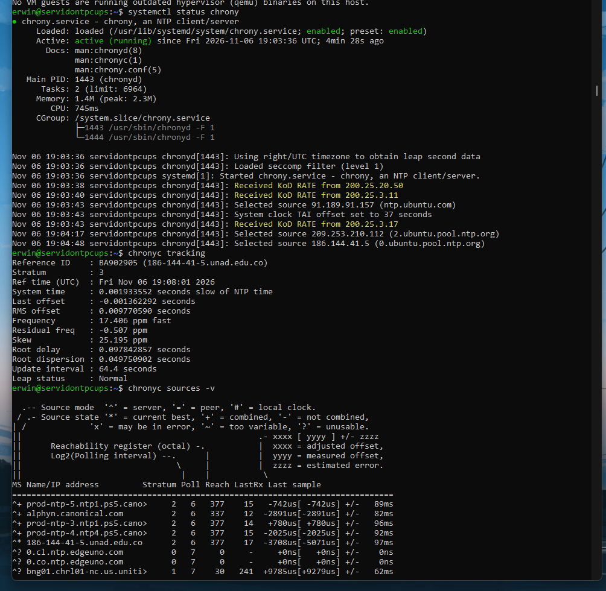

### 2.3. Configuración del servidor y autorización de la red local

Se revisó la configuración de red del servidor y se realizó una copia de seguridad del archivo de Chrony antes de modificarlo:

```bash
ip -4 route
sudo cp /etc/chrony/chrony.conf /etc/chrony/chrony.conf.bak
sudo nano /etc/chrony/chrony.conf
```

En el archivo `/etc/chrony/chrony.conf` se agregó la directiva:

```conf
allow 192.168.18.0/24
```

Esta regla permite que los equipos pertenecientes a la subred `192.168.18.0/24` puedan realizar consultas al servicio NTP del servidor. La autorización debe coincidir con el direccionamiento real de la red donde se implemente el servicio.

**Evidencia 003. Verificación del servicio, puerto NTP y configuración de red**

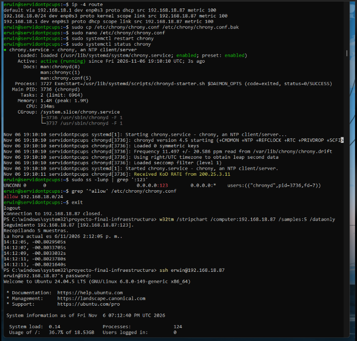

### 2.4. Revisión del archivo de configuración

Se visualizó el contenido del archivo de configuración para comprobar las fuentes de tiempo definidas y los parámetros generales de Chrony:

```bash
cat /etc/chrony/chrony.conf
```

En la configuración se observan servidores del conjunto NTP Pool de Ubuntu, la referencia a las fuentes adicionales y parámetros relacionados con el almacenamiento de información de sincronización. La directiva `allow` se utiliza para autorizar las consultas desde la red local del laboratorio.

**Evidencia 004. Visualización de la configuración de Chrony**

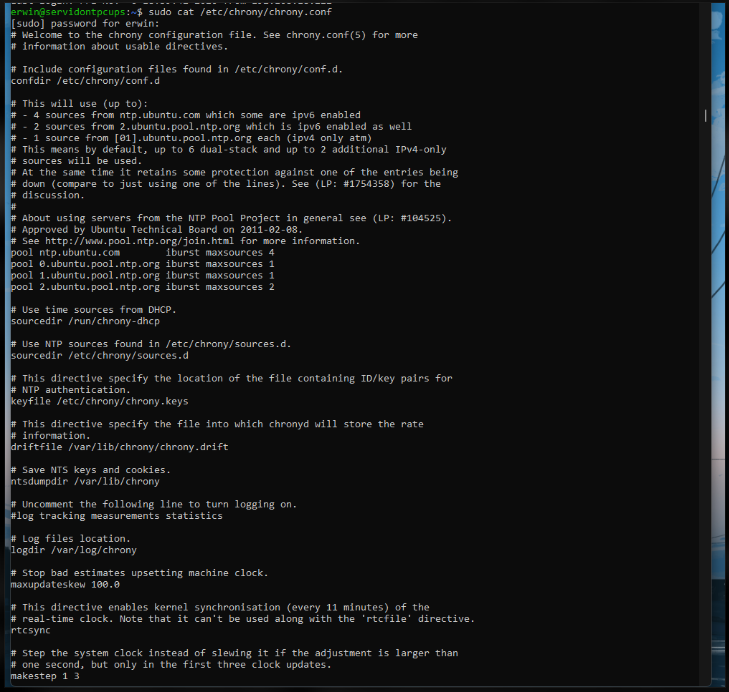

### 2.5. Edición de la configuración y aplicación de cambios

La edición del archivo se realizó con el editor Nano:

```bash
sudo nano /etc/chrony/chrony.conf
```

Se incorporó la regla de autorización para la subred local:

```conf
allow 192.168.18.0/24
```

Después de guardar los cambios, se reinició el servicio para aplicar la configuración:

```bash
sudo systemctl restart chrony
sudo systemctl status chrony
```

La evidencia muestra la edición del archivo y la directiva utilizada para permitir las solicitudes de los clientes de la red de laboratorio.

**Evidencia 005. Organización de las evidencias y archivos del proyecto**

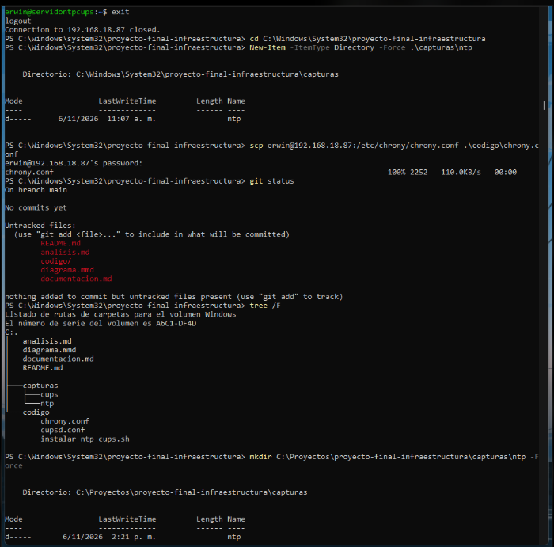

**Evidencia 006. Edición de la configuración de Chrony**

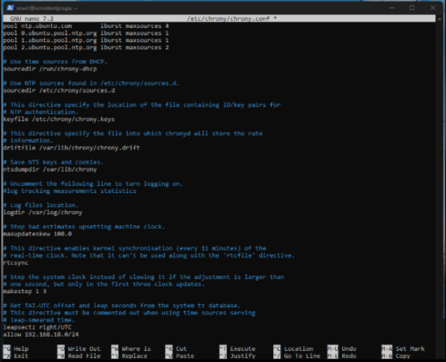

### 2.6. Prueba desde un cliente Windows

Para comprobar la respuesta del servidor desde otro equipo de la red, se utilizó la herramienta `w32tm` de Windows:

```powershell
w32tm /stripchart /computer:192.168.18.87 /samples:5 /dataonly
```

El comando solicita cinco muestras de tiempo al servidor `192.168.18.87` mediante NTP. En la salida se observan las muestras recibidas y sus respectivos desfases.

**Resultado:** el cliente Windows recibió respuestas del servidor NTP y mostró valores de diferencia horaria en las muestras. Esta prueba permite verificar la comunicación con el servicio; por sí sola no demuestra que el servicio de hora de Windows haya quedado reconfigurado permanentemente para utilizar ese servidor.

**Evidencia 007. Prueba de consulta NTP desde un cliente Windows**

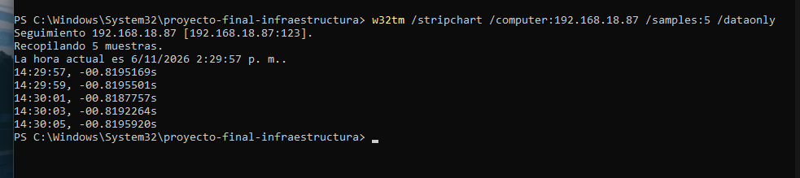

---

## 3. Servicio de impresión CUPS

**Objetivo:** centralizar la administración de trabajos de impresión y habilitar el acceso a la interfaz web desde los equipos autorizados de la red de laboratorio.

### 3.1. Verificación inicial del servicio

Se consultó el estado del servicio CUPS:

```bash
sudo systemctl status cups
```

La salida muestra el servicio `cups.service` como activo y habilitado. También se observa que el servicio es activado mediante los componentes `cups.path` y `cups.socket`, encargados de gestionar las solicitudes de impresión.

**Evidencia 001. Verificación del servicio CUPS**

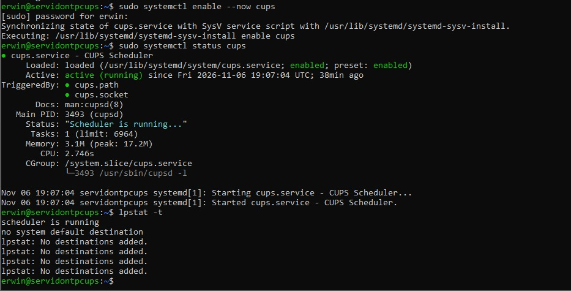

### 3.2. Revisión de la configuración inicial

Se revisó el archivo principal de configuración de CUPS:

```bash
sudo nano /etc/cups/cupsd.conf
```

En la configuración inicial se identificaron parámetros como el puerto `631`, la interfaz web habilitada mediante `WebInterface Yes` y las restricciones de acceso definidas en los bloques `<Location>`. Inicialmente, el servicio estaba limitado a conexiones locales, por lo que fue necesario ajustar la configuración para permitir el acceso desde la red del laboratorio.

**Evidencia 002. Revisión de la configuración inicial de CUPS**

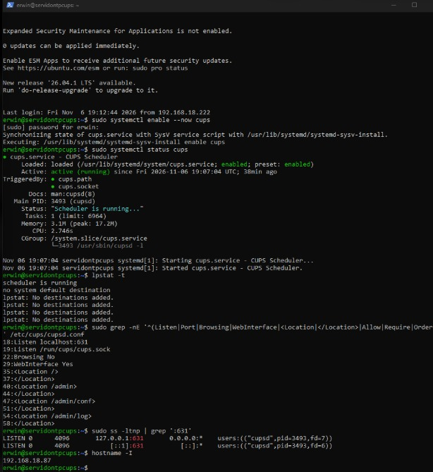

### 3.3. Respaldo y edición del archivo cupsd.conf

Antes de modificar la configuración se creó una copia de seguridad:

```bash
sudo cp /etc/cups/cupsd.conf /etc/cups/cupsd.conf.bak
sudo nano /etc/cups/cupsd.conf
```

El respaldo permite recuperar la configuración anterior en caso de que un cambio produzca un comportamiento no esperado. Posteriormente se modificaron los parámetros de escucha y las reglas de acceso del servicio.

**Evidencia 003. Respaldo y edición de la configuración de CUPS**

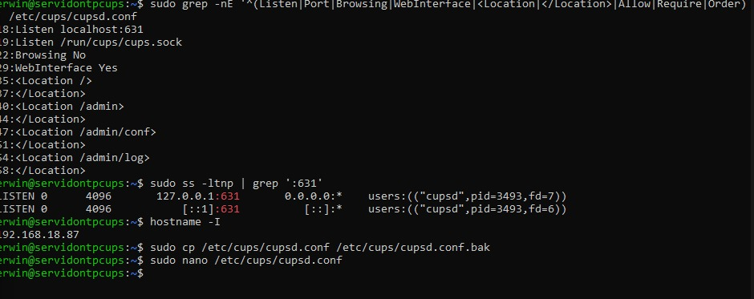

### 3.4. Habilitación del puerto 631

CUPS utiliza el puerto TCP `631` para su interfaz web y la recepción de solicitudes de impresión. Se configuró el servicio para escuchar en dicho puerto y se reinició:

```bash
sudo systemctl restart cups
sudo ss -ltnp | grep ':631'
```

La salida de `ss` permite comprobar las direcciones en las que el proceso `cupsd` está escuchando. En la evidencia se observa el puerto `631` asociado al servicio CUPS.

**Evidencia 004. Verificación del puerto TCP 631**

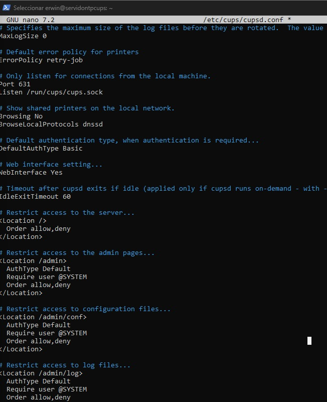

### 3.5. Habilitación del acceso desde la red local

Se agregó la autorización para la subred de laboratorio en el bloque de acceso general:

```conf
<Location />
    Order allow,deny
    Allow from 192.168.18.0/24
</Location>
```

La regla permite el acceso desde los equipos de la subred `192.168.18.0/24`, en concordancia con el direccionamiento utilizado durante las pruebas. Después de guardar los cambios se reinició CUPS y se verificó nuevamente el puerto:

```bash
sudo systemctl restart cups
sudo ss -ltnp | grep ':631'
```

**Evidencia 005. Habilitación del acceso desde la red local**

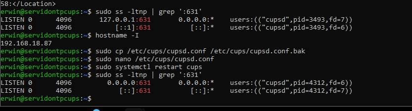

### 3.6. Verificación de las reglas de acceso

Se revisaron los bloques de configuración relacionados con el acceso al servidor, la administración y los archivos de configuración. En las reglas se observa la autorización de la red local, manteniendo los requisitos de autenticación para las operaciones administrativas.

Las secciones administrativas conservan directivas como `Require user @SYSTEM`. Esto es importante porque permitir el acceso desde una subred no sustituye la autenticación requerida para administrar CUPS.

**Evidencia 006. Verificación de las reglas de acceso de CUPS**

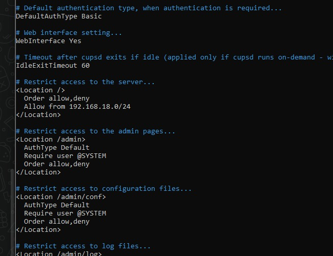

### 3.7. Verificación de la interfaz web

Desde un navegador de un equipo de la red se ingresó a la dirección:

```text
http://192.168.18.87:631
```

La página principal de CUPS permitió comprobar que la interfaz web estaba disponible desde la red de laboratorio. En ella se presentan las secciones para usuarios, administradores y desarrolladores.

**Evidencia 007. Verificación de acceso a la interfaz web**

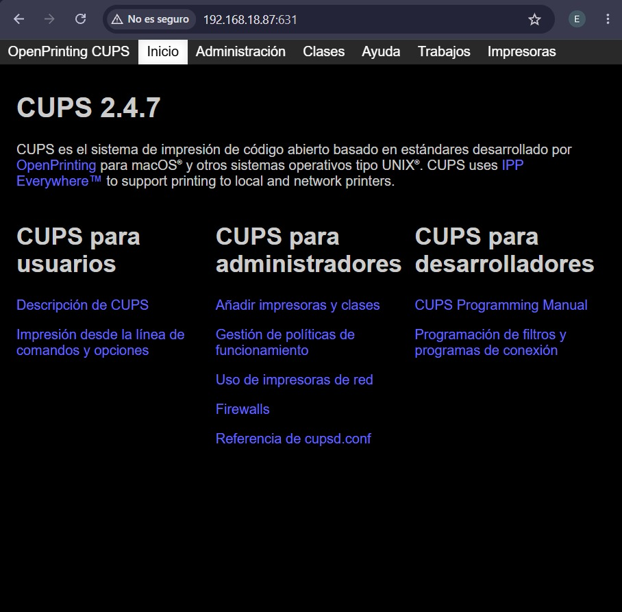

**Evidencia 008. Interfaz principal de CUPS**


### 3.8. Configuración de permisos administrativos

Para permitir que el usuario del sistema realizara tareas de administración de impresoras, se agregó al grupo `lpadmin`:

```bash
sudo usermod -aG lpadmin erwin
```

Después de aplicar el cambio se inició una nueva sesión y se verificaron los grupos del usuario:

```bash
groups
```

La pertenencia al grupo `lpadmin` otorga permisos para administrar impresoras mediante CUPS, de acuerdo con las políticas del sistema.

**Evidencia 009. Configuración de permisos administrativos**

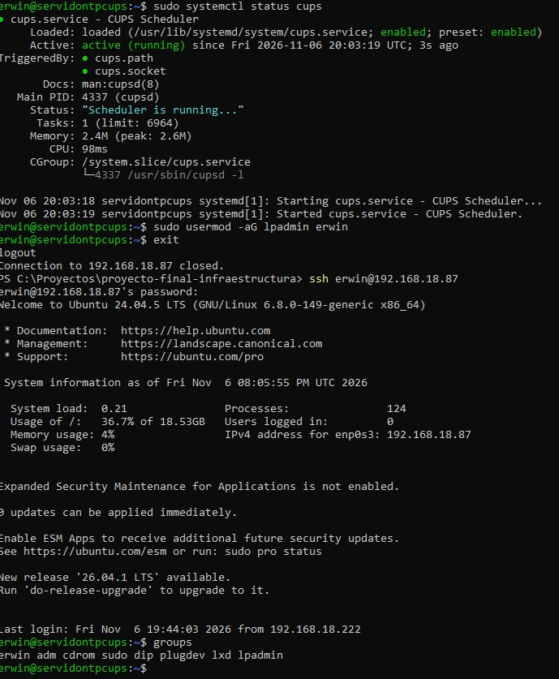

### 3.9. Acceso al panel de administración

Se ingresó a la sección **Administración** de la interfaz web de CUPS:

```text
http://192.168.18.87:631/admin
```

Desde este panel se encuentran las opciones para añadir y administrar impresoras, administrar clases y consultar trabajos. Las operaciones administrativas pueden solicitar autenticación del usuario autorizado.

Durante el acceso también se presentó el aviso del navegador relacionado con el certificado HTTPS no reconocido. Este aviso corresponde a la confianza del certificado utilizado y no debe confundirse con la disponibilidad del servicio CUPS.

**Evidencia 010. Acceso al panel de administración de CUPS**

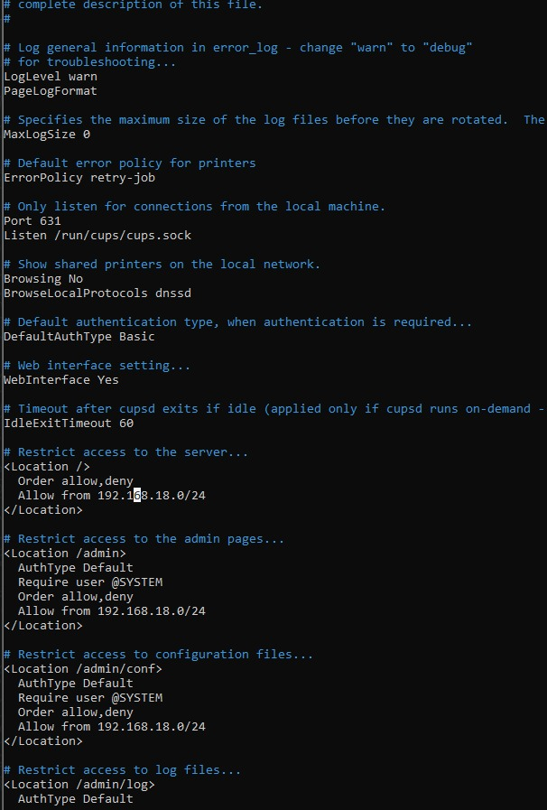

### 3.10. Prueba de la interfaz para añadir impresoras

Desde el panel de administración se seleccionó la opción **Añadir impresora**. La interfaz mostró las alternativas de conexión disponibles, entre ellas IPP, IPPS, HTTP, LPD/LPR y AppSocket/HP JetDirect.

Esta evidencia confirma que la interfaz de administración permite iniciar el procedimiento para registrar una impresora. No se interpreta como evidencia de que se haya conectado o instalado una impresora física.

**Evidencia 011. Prueba de la interfaz para añadir impresoras**

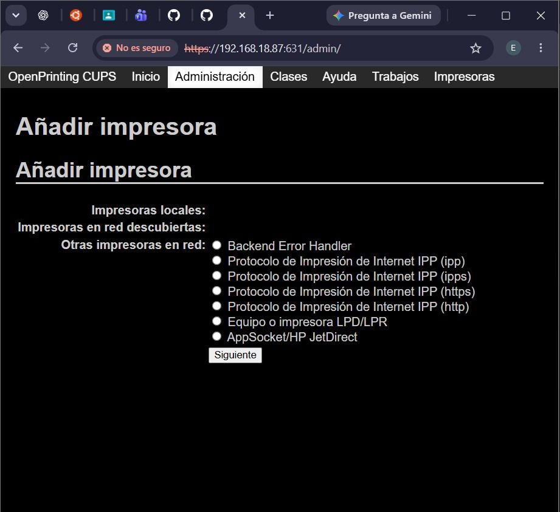

---

## 4. Servicio CUPS-PDF

**Objetivo:** validar el procesamiento de trabajos de impresión mediante una impresora virtual y generar archivos PDF sin requerir un dispositivo físico.

### 4.1. Instalación del controlador CUPS-PDF

Se actualizaron los repositorios y se instaló el controlador:

```bash
sudo apt update
sudo apt install printer-driver-cups-pdf -y
```

El paquete instala el controlador que permite utilizar una cola de impresión virtual para convertir los documentos enviados a ella en archivos PDF.

**Evidencia 012. Instalación del controlador CUPS-PDF**

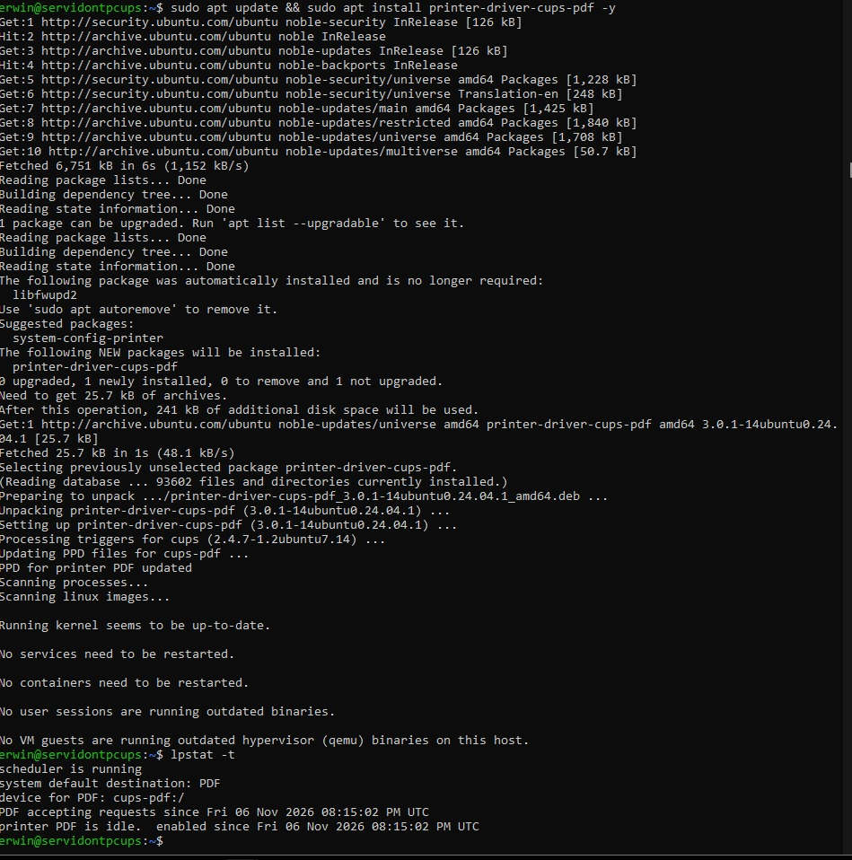

### 4.2. Verificación de la cola PDF

Se consultó el estado de las colas y dispositivos de impresión:

```bash
lpstat -t
```

En la salida se identificó la cola `PDF` asociada al dispositivo `cups-pdf:/`. Esto permite reconocer que CUPS dispone de una impresora virtual para realizar las pruebas.

### 4.3. Generación de un trabajo de prueba

Se creó un archivo de texto con información de prueba y se envió a la cola PDF:

```bash
printf 'Prueba de impresion CUPS\nServidor: servidontpcups\nServicio: CUPS-PDF\n' > ~/prueba-cups.txt
lp -d PDF ~/prueba-cups.txt
```

El comando `lp` devolvió un identificador de trabajo, lo que indica que CUPS recibió la solicitud de impresión.

**Evidencia 013. Generación del trabajo de prueba con CUPS-PDF**

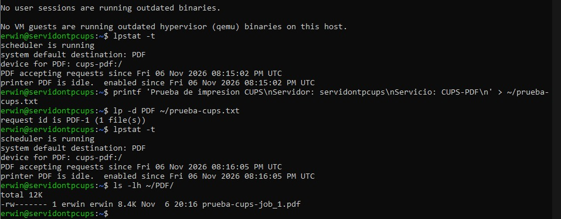

### 4.4. Verificación del trabajo completado y del archivo generado

Se consultaron los trabajos completados y el estado de la cola:

```bash
lpstat -W completed -o
lpstat -p PDF -l
```

También se revisó el directorio de salida:

```bash
ls -lh ~/PDF/
```

En la evidencia se observa el trabajo `PDF-1` con estado completado. En el directorio de salida se generó el archivo `prueba-cups-job_1.pdf`.

**Resultado:** el trabajo fue procesado por la cola virtual PDF y se generó un archivo PDF en el servidor. Esta prueba valida el flujo de impresión virtual; no demuestra la impresión física en un dispositivo.

**Evidencia 014. Verificación del trabajo de impresión completado**

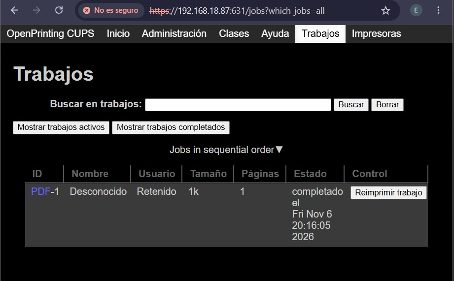

---

## 5. Parámetros técnicos de los servicios

| Servicio | Dirección / recurso | Puerto | Protocolo | Función |
|---|---|---:|---|---|
| Chrony / NTP | `192.168.18.87` | 123 | UDP | Sincronización y consulta de hora. |
| CUPS | `192.168.18.87` | 631 | TCP | Interfaz web, administración y recepción de trabajos de impresión. |
| CUPS-PDF | Cola virtual `PDF` | — | CUPS | Conversión de trabajos de impresión a archivos PDF. |

La dirección IP y la subred corresponden exclusivamente al entorno de laboratorio utilizado en las pruebas.

## 6. Resultados de la implementación

La implementación permitió configurar y verificar dos servicios principales de infraestructura:

- **Chrony:** se instaló y habilitó el servicio, se revisaron sus fuentes de tiempo y su estado de sincronización, se autorizó la subred de laboratorio y se realizó una consulta desde un cliente Windows. Las evidencias muestran que el servidor respondió a las solicitudes de consulta horaria.
- **CUPS:** se verificó el servicio, se ajustó su configuración para permitir el acceso desde la red local, se comprobó la disponibilidad de la interfaz web y se accedió al panel de administración.
- **CUPS-PDF:** se instaló el controlador de impresión virtual, se envió un documento de prueba a la cola `PDF` y se verificó la finalización del trabajo y la generación del archivo PDF.

Los resultados corresponden al entorno académico de laboratorio. No se afirma que estos servicios estén desplegados en la infraestructura productiva de Bavaria ni que la organización utilice el direccionamiento presentado.

## 7. Archivos y evidencias del repositorio

La documentación se apoya en la siguiente organización de archivos:

| Archivo o directorio | Descripción |
|---|---|
| `documentacion.md` | Procedimientos de instalación, configuración y verificación de los servicios. |
| `capturas/ntp/` | Evidencias de instalación, configuración y pruebas de Chrony. |
| `capturas/cups/` | Evidencias de configuración, acceso y administración de CUPS. |
| `codigo/chrony.conf` | Archivo de configuración de Chrony utilizado como referencia del proyecto. |
| `codigo/cupsd.conf` | Archivo de configuración de CUPS documentado para el laboratorio. |
| `codigo/cups-pdf.conf` | Archivo relacionado con la configuración de CUPS-PDF, si se conserva en el repositorio. |
| `README.md` | Presentación general y alcance del proyecto. |
| `analisis.md` | Contexto, necesidades consideradas y diseño de los servicios. |

## 8. Consideraciones de seguridad y alcance

- La regla `allow 192.168.18.0/24` de Chrony y las reglas `Allow from 192.168.18.0/24` de CUPS corresponden a la red de laboratorio. Deben ajustarse antes de reutilizar la configuración en otra red.
- El acceso a la interfaz web de CUPS no implica que todas las operaciones administrativas estén abiertas. Las acciones de administración deben conservar autenticación y autorización.
- La advertencia del navegador sobre el certificado HTTPS debe resolverse mediante un certificado confiable si el servicio se utiliza en un entorno real.
- CUPS-PDF es una impresora virtual y no sustituye la validación de una impresora física.
- Antes de trasladar la solución a un entorno productivo de Bavaria se deben levantar los requisitos reales, validar la topología de red, definir políticas de acceso y establecer controles de seguridad, disponibilidad y respaldo.
